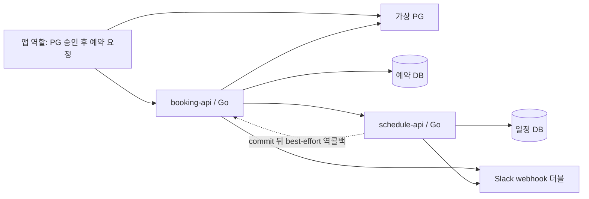

# Booking Compensation Lab

선결제 뒤 예약이 실패하거나 두 서버의 상태가 달라질 때 무엇이 남는지 확인한다. 회사에서 경험한 문제와 비슷한 상황을 합성 데이터로 재현하고, 핵심 흐름을 Go로 작성하며 Java/Spring과 비교해 학습한다. 내부 코드·스키마·업무 정책·실제 데이터는 포함하지 않는다.

**각자 실행하는 Go 서버 두 개와 DB 두 개**가 중심이다. 역할을 선택하는 단일 바이너리나 제품 코드의 장애 주입 API는 없다.

[실험 계획](PLAN.md) · [검증 기록과 결과](RESEARCH-RECORD.md) · [Go/Spring 실행 단계 비교](GO-AND-SPRING.md)

## 먼저 읽을 구조

```text
booking-compensation/
├── booking-api/                    # 독립 Go module
│   ├── cmd/server/                 # main·설정·조립·시작/종료
│   ├── internal/
│   │   ├── booking/                # 모델·생성·취소·역콜백·SQL
│   │   ├── httpapi/                # 라우팅·JSON·HTTP 오류 변환
│   │   └── client/                 # 일정 서버·PG·Slack HTTP adapter
│   ├── db/schema.sql               # users/bookings/point_entries/payments
│   ├── db/fixtures.sql             # 개발용 합성 사용자 200명
│   └── Dockerfile, go.mod, go.sum, .env.example
├── schedule-api/                   # 독립 Go module
│   ├── cmd/server/main.go
│   ├── internal/
│   │   ├── schedule/               # 모델·생성·취소/복원·변경·완료·SQL
│   │   ├── httpapi/
│   │   └── client/                 # 역콜백·Slack HTTP adapter
│   ├── db/schema.sql               # resources/appointments/appointment_events
│   ├── db/fixtures.sql             # 합성 자원 200개
│   └── Dockerfile, go.mod, go.sum, .env.example
├── stubs/                          # Docker 외부 PG·Slack 더블와 단위 검사
├── compose.yaml
├── scripts/build.sh                # ./cmd/server를 각각 빌드
├── scripts/verify.py                # 실제 HTTP·독립 psql 검증
└── results/                        # 성공/실패 원본·실행 당시 소스·SHA
```

Go 공식 문서는 서버를 `cmd`와 `internal`로 조직하는 예를 제공한다. **이번 책임 분리는 이 랩의 선택**이며 Go 전체에 단일 MVC/클린 아키텍처가 강제된다는 뜻이 아니다. [Go module layout](https://go.dev/doc/modules/layout#server-project)

| 책임 | 위치 | 경계 |
|---|---|---|
| 실행·조립 | `cmd/server` | 환경 검증, pool 생성·종료, 구체 객체 연결, HTTP 수명 |
| HTTP 입출력 | `internal/httpapi` | 요청 JSON/경로·Context와 응답/상태코드. SQL이나 업무 tx를 시작하지 않음 |
| 업무 순서 | booking의 `create.go`/`cancel.go`/`callbacks.go`, schedule의 `create.go`/`cancel.go`/`complete.go`/`reschedule.go` | 트랜잭션·잠금 호출 순서·원격 효과·보상·상태 전이. net/http에 의존하지 않음 |
| 저장 | 각 업무 패키지의 `postgres.go`·`postgres_*.go` | pgx SQL과 DB 잠금. HTTP 호출·commit을 대신 수행하지 않음 |
| 외부 효과 | `internal/client` | 일정/PG/Slack protocol을 업무 경계의 결과/오류로 변환 |

외부 호출에만 업무 Service가 소비하는 비공개 작은 interface를 같은 업무 패키지에 둔다. SQL 저장소는 같은 패키지의 비공개 `store` 구체 타입이며 범용 repository/UnitOfWork/DI container를 만들지 않는다. `NewService(db, ...)`는 이 저장소를 내부에서 구성하고, DB pool의 생성·종료는 `cmd/server`가 맡는다. 업무 service가 `Begin`/`Commit`/`defer rollback`을 명시해서 HTTP 왕복과 DB 잠금의 생명주기를 읽을 수 있다. HTTP 상태코드는 `httpapi`에서 업무 오류를 변환한다.

한 곳에서만 사용하던 `internal/app`은 별도 공개 API를 유지할 이유가 없어 `cmd/server/run.go`·`config.go`로 합쳤다. `booking.go`/`appointment.go`에는 모델·입력 규칙을 둔다. booking은 생성·취소·수신 콜백별로, schedule은 생성·취소/복원·완료·변경·전송 콜백별로 파일을 나눴다. 외부 계약은 각 `dependencies.go`에 둔다. booking은 `postgres.go`에 공통 tx/오류 처리를, `postgres_booking.go`/`postgres_user.go`/`postgres_payment.go`에 책임별 SQL을 둔다. 여러 저장 호출과 잠금 순서는 Service가 총괄한다. schedule은 공통 tx/오류를 `postgres.go`, 일정/이력 SQL을 `postgres_appointment.go`, 자원 잠금/완료 수를 `postgres_resource.go`로 나눴다. Service는 pgx에 의존하며 엄격한 Clean Architecture를 주장하지 않는다. 외부 adapter는 소수의 실제 연동을 묶은 `internal/client`에 유지하고, 독립 module 사이에 공유 프레임워크를 만들지 않는다. 요청부터 여러 테이블 저장까지는 [Booking API 안내](booking-api/README.md#코드-읽는-순서)와 [Schedule API 안내](schedule-api/README.md#코드-읽는-순서)를 따른다.

PostgreSQL은 기존 **pgx/pgxpool**로 통일했다. sqlx는 `database/sql` 확장이며 native pgxpool에 반드시 붙여야 하는 계층이 아니다. 현재 SQL·tx 처리에 추가 패키지가 필요하지 않아 ORM·sqlx·라우팅 프레임워크를 설치하지 않았다. [pgx 선택 지침](https://github.com/jackc/pgx#choosing-between-the-pgx-and-databasesql-interfaces), [sqlx 문서](https://jmoiron.github.io/sqlx/)

두 Go 프로젝트는 서로 import하지 않는다. 각각 `net/http`와 pgx를 사용하고 서로 HTTP로만 통신한다. DB도 각자 소유하며 상대 DB를 직접 읽지 않는다. 검증기만 두 DB를 별도 세션에서 관찰한다.



## 핵심 흐름과 한계

- **생성:** 입력 검증 → 사용자 행 잠금 → 사용자 일정 중복 검사 → 원격 일정 생성 → 잔액 검사·로컬 예약/포인트 차감 → PG 승인 조회 → commit → Slack. 로컬 저장 실패면 원격 일정을 보상 취소한다. 생성 실패에 대한 PG 자동 환불은 아직 없다.
- **취소:** 사용자 키 조회 → 사용자 행 → 예약 행 잠금 → 취소 상태 재확인 → 원격 일정 취소 → 로컬 상태·포인트 환급·PG 환불 → commit. 중간 실패면 원격 취소를 되돌리려 시도한다. 원격 환불은 로컬 rollback으로 취소되지 않는다.
- **일정:** `[start,end)` 활성 점유를 자원/UTC 일자 advisory lock으로 보호한다. 변경·완료·취소는 행을 잠근 뒤 최신 상태를 판정한다. 완료 수와 이력은 같은 일정 DB 트랜잭션에 포함한다. 모든 진입 경로에서 겹침을 막는 합성 계약이며 관리자 겹침 허용 같은 업무 예외는 구현하지 않았다.
- **역콜백:** 일정 DB commit 뒤 별도 goroutine으로 전송한다. 취소된 예약을 늦은 변경/완료 콜백이 되살리지 않게 한다. 프로세스 중단·전송 실패에 지속 재시도나 재조정은 없다.
- **PG:** `/success`, `/failure`, 조회·환불이 1초 후 응답한다. 메모리 승인/거절/환불 상태와 멱등 환불을 제공한다. `refund_outcome`은 더블의 실패 시나리오 입력이며 Go 제품 API의 설정이 아니다.
- **Slack:** webhook 경로별 **수락 간격 1초**, 초과는 즉시 `429`와 `Retry-After`, 수락 응답은 **1초 지연**이다. 처리율 제한과 응답 지연은 다른 조건이다. 실제 Slack은 짧은 버스트도 허용하므로 이 엄격한 더블을 실제 한도 전체와 동일시하지 않는다. [공식 한도](https://docs.slack.dev/apis/web-api/rate-limits/)

인증·가격/기업/이용권 정책·화면·운영 용량은 범위 밖이다. 포인트/금액은 실험용 정수 단위다. Valkey는 현재 핵심 흐름에서 사용하지 않아 기본 기동에서 제외했으며 `cache` profile로만 남겨 두었다. 슬롯 보호는 DB가 담당한다.

## Docker로 실행

Go·Docker·Python 3가 필요하다. 검증 환경은 Go 1.27.3, pgx v5.11.0, PostgreSQL 18.6이다. DB·Python·선택 Valkey 이미지는 digest 고정이다.

```sh
cd labs/booking-compensation
export GOCACHE="${TMPDIR:-/tmp}/booking-compensation-go-cache"
sh scripts/build.sh
docker compose up -d --no-build --wait --wait-timeout 60
docker compose ps
curl --fail http://127.0.0.1:18090/health
curl --fail http://127.0.0.1:18091/health
```

| 대상 | 호스트 주소 | 컨테이너 내부 주소 |
|---|---|---|
| 예약 API | `127.0.0.1:18090` | `booking-api:8080` |
| 일정 API | `127.0.0.1:18091` | `schedule-api:8080` |
| PG | `127.0.0.1:18092` | `pg:8080` |
| Slack | `127.0.0.1:18093` | `slack:8080` |
| 예약 DB | `127.0.0.1:15490/bookings` | `booking-db:5432/bookings` |
| 일정 DB | `127.0.0.1:15491/schedules` | `schedule-db:5432/schedules` |

전용 bridge에서 실행하고 **모든 게시 포트는 loopback**에만 바인딩한다. Docker 네트워크 자체가 외부 egress를 차단하는 구성은 아니다. Go의 HTTP/DB 목적지는 Docker 서비스명·loopback만 허용하고 더블은 outbound 호출을 하지 않는다. 회사 폴더·덤프·env·실제 PG/Slack 자격증명은 사용하지 않는다. 외부 웹사이트에 부하를 보내지 않는다.

## 서버를 각각 `go run`으로 실행

외부 의존성만 Docker로 두고 Go 서버를 터미널에서 실행할 수도 있다. 먼저 이 랩의 Go 컨테이너 두 개를 멈춰 포트를 비운다. DB/PG/Slack은 유지한다.

```sh
# labs/booking-compensation에서
# 최초 기동이면: docker compose up -d booking-db schedule-db pg slack
docker compose stop booking-api schedule-api
```

터미널 1:

```sh
cd labs/booking-compensation/booking-api
set -a
. ./.env.example
set +a
go run ./cmd/server
```

터미널 2:

```sh
cd labs/booking-compensation/schedule-api
set -a
. ./.env.example
set +a
go run ./cmd/server
```

각 프로젝트의 `.env.example`은 합성 로컬 주소만 포함한다. 두 서버 모두 종료한 뒤 `docker compose start schedule-api booking-api`로 Docker 실행에 복귀한다.

## 로컬 실행의 네트워크 경계

Go 서버와 PG/Slack 더블의 기본 listen 주소는 `127.0.0.1:8080`이다. 직접 실행할 때는 `.env.example`의 loopback 포트를 사용한다. Docker Compose만 컨테이너 내부 통신을 위해 `LISTEN_ADDR=0.0.0.0:8080`을 명시하며 호스트 publish는 기존 `127.0.0.1`을 유지한다. wildcard 주소를 호스트에서 쓰면 LAN에 노출되므로 복사하지 않는다. 인증 없는 실험용 API를 공개 서버로 재사용하지 않는다.

Go의 의존성·health HTTP client와 더블 health probe는 환경 프록시를 우회한다. 의존성 client는 redirect도 따르지 않는다. 허용된 내부 서비스 호스트의 DNS·Docker 네트워크를 신뢰하는 로컬 실험이며, 이것이 공개 서비스의 인증·SSRF 방어 전체를 대신하지는 않는다. `go-load-test`는 기존 numeric loopback 제한과 proxy 차단이 있어 이번에 변경하지 않았다.

## 직접 API 따라가기

깨끗한 합성 fixture 또는 아직 사용하지 않은 `demo` ID에서 실행한다. 사용자 200·자원 200은 자동 검증의 burst와 겹치지 않는다.

```sh
# 앱이 PG 승인을 받은 뒤 예약을 보낸다는 순서다.
curl -sS http://127.0.0.1:18092/payments/demo-payment/success \
  -H 'Content-Type: application/json' -d '{"amount":60}'

curl -sS http://127.0.0.1:18090/bookings \
  -H 'Content-Type: application/json' \
  -d '{"id":"demo","user_id":200,"resource_id":200,"start":"2030-01-01T12:00:00Z","end":"2030-01-01T12:30:00Z","amount":100,"points":40,"payment_id":"demo-payment"}'

curl -sS http://127.0.0.1:18090/bookings/demo
curl -sS http://127.0.0.1:18090/users/200
curl -sS -X POST http://127.0.0.1:18090/bookings/demo/cancel
curl -sS http://127.0.0.1:18092/payments/demo-payment
```

| 서버 | API | 책임 |
|---|---|---|
| 예약 | `POST /bookings`, `GET /bookings/{id}`, `GET /users/{id}` | 생성·현재 예약/잔액 조회 |
| 예약 | `POST /bookings/{id}/cancel` | 원격 선행 취소·로컬 환급 |
| 예약 | `POST /internal/appointments/{id}/{cancel,reschedule,complete}` | 일정 서버의 역콜백 수신 |
| 일정 | `POST /appointments`, `POST /internal/appointments`, `GET /appointments/{id}` | 직접/예약 서버 경유 생성·조회 |
| 일정 | `PATCH /appointments/{id}` | 대기 중 일정 변경 |
| 일정 | `POST /appointments/{id}/{cancel,complete}` | 상태 전이·commit 뒤 역콜백 |
| 일정 | `DELETE /internal/appointments/{id}`, `POST /internal/appointments/{id}/{cancel,restore}` | 생성 보상·내부 취소·취소 역보상 |
| PG | `POST /payments/{id}/{success,failure}`, `GET /payments/{id}`, `POST /payments/{id}/refund` | 선결제·검증·환불 |
| 더블 | `GET /payments`(PG), `GET /stats`(Slack) | 외부 효과의 관측 기록 |
| Slack | `POST /hooks/{channel}` | `{"text":"..."}` webhook |

## 검사·증거·재실행

```sh
# 각각 독립 module이다. 루트에는 통합 Go module을 두지 않는다.
(cd booking-api && go test -count=1 ./... && go test -race -count=1 ./... && go vet ./...)
(cd schedule-api && go test -count=1 ./... && go test -race -count=1 ./... && go vet ./...)
PYTHONDONTWRITEBYTECODE=1 python3 -m unittest discover -s stubs -p test_dependencies.py -v
python3 scripts/verify.py --session my-fresh-run
python3 scripts/summarize.py my-fresh-run
```

검증기는 **새 DB·새 PG 상태에서만** 시작하며 기존 데이터나 동일 결과 디렉터리를 덮어쓰지 않는다. 제품 코드에 `/lab/*`나 Fault 헤더를 넣지 않고 실제 API, 업무 거절, 별도 DB 세션의 잠금, 외부 더블의 응답, 서버 중단/복구로 확인한다. HTTP barrier는 모든 DB 실행 순서를 통제하는 장치는 아니다.

결과에는 원본 요청/응답·최종 DB 조회·실행 명령/환경·소스/바이너리 SHA·실행 당시 소스 사본·로그를 보존한다. 예상한 **실패 재현도 PASS**이므로 전체 PASS가 자동 복구 완료를 뜻하지 않는다. 현재 결과와 미검증 범위는 [Research Record](RESEARCH-RECORD.md)의 v3 부분을 따른다.

DB는 named volume이라 `docker compose down`만으로 지워지지 않는다. PG/Slack 더블은 메모리라 재생성하면 초기화된다. 이 비대칭은 재시작 일관성을 구현했다는 뜻이 아니다. 새 실험이 필요하면 먼저 원본을 보존하고, 아래 명령으로 **이 랩의 합성 상태만** 초기화한다.

```sh
# 예약·결제 등 합성 상태를 지우므로 증거 보존 후에만 실행한다.
docker compose down -v
docker compose up -d --no-build --wait --wait-timeout 60
```

v1/v2 원본과 당시 역할 분기 소스는 `results/2026-10-23-01/`, `results/2026-10-23-02/`에 남아 있다. 현재 두 module의 코드와 섞어 설명하거나 환경이 다른 결과를 성능 개선 전후로 비교하지 않는다. Commit·Push·배포·글 공개는 이 작업에 포함하지 않는다.
