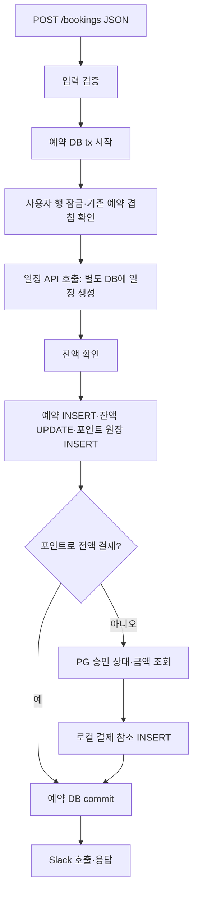

# Booking API

독립 Go module이다. `cmd/server/main.go` → 같은 패키지의 `run.go`/`config.go`에서 환경·pool·client·service·HTTP handler를 명시적으로 조립한다. `internal/httpapi`는 요청/응답, `internal/booking`은 예약 업무 순서·트랜잭션, 같은 패키지의 `postgres_*.go`는 책임별 SQL, `internal/client`는 외부 HTTP를 맡는다.

DB 소유: `users, bookings, point_entries, payments`. 상대 서버 DB를 직접 읽지 않는다. [db/schema.sql](db/schema.sql)과 합성 개발 데이터 [db/fixtures.sql](db/fixtures.sql)은 분리했다. 스키마 내용은 v3와 같고 경로만 옮겼다. 별도 migration runner를 추가한 것은 아니다.

```sh
go test -count=1 ./...
go test -race -count=1 ./...
go vet ./...
# 의존성 기동과 환경변수 설정 후
go run ./cmd/server
```

환경은 [.env.example](.env.example), 전체 기동·API와 책임 표는 [Lab README](../README.md), 학습할 경계는 [Go/Spring 비교](../GO-AND-SPRING.md)를 따른다. 외부 의존성에만 같은 booking 패키지의 비공개 작은 소비자 interface를 사용한다. Service가 비공개 구체 `store`를 구성하고 pool 종료는 main이 맡으며, tx 경계는 각 업무 흐름에 드러난다. 제품 코드의 실험 제어 경로·ORM·sqlx·DI container는 없다. 기존 보상/역콜백의 내구성 한계를 해결하는 작업은 이번 구조 변경에 포함하지 않는다.

## 코드 읽는 순서

| 궁금한 점 | 파일 | 읽을 내용 |
|---|---|---|
| HTTP 요청은 어디서 받나? | [handler.go](internal/httpapi/handler.go) | JSON 파싱·요청 Context·Service 호출·응답 |
| 요청/조회 데이터는 무엇인가? | [booking.go](internal/booking/booking.go) | Booking·User·Interval·입력 규칙 |
| 예약 흐름이 외부에 무엇을 요구하나? | [dependencies.go](internal/booking/dependencies.go) | scheduler/payments/notifier라는 소비자 interface |
| 그 의존성을 누가 연결하나? | [run.go](cmd/server/run.go), [service.go](internal/booking/service.go) | 실제 client 연결·Service 구성·공통 조회/알림 |
| 예약 생성은 어떤 순서인가? | [create.go](internal/booking/create.go) | 생성·차감/승인 확인·원격 생성 보상 |
| 예약 취소와 환불은 어떻게 묶이나? | [cancel.go](internal/booking/cancel.go) | 취소·로컬 환급·PG 환불·실패 시 일정 복원 시도 |
| 일정 서버의 변경을 어떻게 받나? | [callbacks.go](internal/booking/callbacks.go) | 역콜백 진입·변경/완료 반영·취소 상태 보호 |
| 공통 DB 처리는 어디에 있나? | [postgres.go](internal/booking/postgres.go) | store·tx 시작/정리·DB 오류 변환 |
| 예약을 어디서 읽고 쓰나? | [postgres_booking.go](internal/booking/postgres_booking.go) | 예약 키 조회·예약 행 잠금·저장·상태 변경·조회 응답 JOIN |
| 잔액과 포인트 원장은 누가 쓰나? | [postgres_user.go](internal/booking/postgres_user.go) | 사용자 행 잠금·잔액 차감/환급·원장 기록 |
| 결제 참조는 누가 쓰나? | [postgres_payment.go](internal/booking/postgres_payment.go), [schema.sql](db/schema.sql) | 로컬 결제 참조 INSERT/조회/상태 변경·DB 제약 |

`dependencies.go`는 결제·일정·알림의 **구현이나 데이터 모델**이 아니다. 예약 흐름이 사용하는 메서드 집합이다. 실제 구현은 [일정 HTTP client](internal/client/schedule.go), [PG client](internal/client/payment.go), [Slack client](internal/client/slack.go)에 있다. interface를 사용하는 booking 패키지에 두고 파일만 나눴다. 별도 패키지·Service 타입을 추가한 것이 아니며 모든 업무 메서드는 같은 `booking.Service`에 속한다. [Go interface 지침](https://go.dev/wiki/CodeReviewComments#interfaces), [같은 패키지의 여러 파일](https://go.dev/doc/modules/layout#basic-package)

## 예약 생성 하나를 따라가기

앱이 먼저 PG 승인을 받은 다음 `POST /bookings`를 호출한다. 이 API의 PG 호출은 새 결제가 아니라 **기존 승인 상태와 금액 조회**다. 원격 일정 DB와 예약 DB를 묶는 분산 트랜잭션은 없다.



그림은 정상 경로다. `create.go`에서 실패 경로까지 같이 읽는다.

- JSON 형식/크기는 HTTP 경계에서, 식별자·금액·기간·서버 전용 필드는 `Booking.Validate`에서 확인한다.
- 사용자의 존재·최신 잔액은 tx 안의 행 잠금으로 읽고, 같은 사용자의 활성 예약 겹침도 그 뒤 확인한다. 동시 요청에서 달라질 수 있는 상태를 모두 tx 밖에서 미리 확인했다고 끝낼 수 없다.
- 현재 잔액 부족 검사는 원격 일정 생성 뒤다. 이는 기존 실험에서 늦은 거절·보상 비용을 관찰하기 위한 순서이며 권장 운영 순서라고 주장하지 않는다. 이번 파일 분리에서는 바꾸지 않았다.
- `saveAndVerifyPayment`는 잔액 판정 → `insertBooking` → 필요 시 `debitPoints` → 필요 시 PG 조회 → `insertPayment`를 수행한다. 이름에서 DB 저장 외의 호출도 드러나게 했다. 포인트가 0이면 원장 INSERT를 생략하고, 포인트 전액이면 PG 조회/결제 참조 INSERT를 생략한다.
- SQL 메서드들이 받은 **같은 tx**에 예약·잔액·원장·결제 참조를 쓴다. 각 메서드가 별도 commit하는 구조가 아니다. 외래 키·CHECK·원장 키 제약도 저장 시 검증한다.
- PG 조회·일정 API가 tx 실행 도중에 호출돼도 그 외부 효과가 예약 DB tx에 참여하는 것은 아니다. `saveAndVerifyPayment` 실패 뒤에는 원격 일정을 보상 취소하고 로컬 tx를 rollback한다. 그 보상도 실패할 수 있으며, commit 실패의 공백과 생성 실패 후 PG 자동 환불 미구현도 그대로다.
- commit 후 Slack을 보내지만 실패하면 전달 보장 없이 로그를 남긴다. 이 파일 분리는 복구 정책을 추가하지 않는다.

## 모델 하나와 여러 테이블의 관계

요청 하나가 여러 테이블을 갱신할 수 있다. Go struct 수가 테이블 수와 같아야 하는 것은 아니다. 이 구현은 ORM 없이 SQL에 필요한 값을 직접 전달한다.

| 테이블/데이터 | 현재 읽기·쓰기 형태 |
|---|---|
| users | 생성 시 id로 기존 사용자의 잔액을 잠금 조회하고 차감한다. 신규 사용자를 만들지 않는다. 별도 조회 응답에는 User를 쓴다. |
| bookings | Booking의 예약 필드를 INSERT하고, 조회 시 Booking에 Scan한다. |
| point_entries | 예약 id·user id·DEBIT/CREDIT·amount를 SQL 인자로 기록한다. 사용하지 않는 원장 엔티티 struct는 없다. |
| payments | PG id·예약 id·남은 금액·상태를 로컬 참조로 저장한다. PG 응답은 client 내부의 작은 응답 struct로 읽는다. |
| 원격 일정 | 일정 API에 필요한 값만 JSON으로 보내고 ID를 받는다. 상대 DB에 직접 쓰지 않는다. |

현재 Booking은 생성 입력과 조회 응답에 재사용된다. AppointmentID/Status는 서버가 채우며 생성 입력에서 비어 있지 않으면 거절한다. 입력·저장 모델·응답이 같은 개념이라는 보편 규칙이 아니라 작은 현재 계약의 재사용이다. 이미 서버가 채우는 필드와 클라이언트 입력은 다르며, 그 구분을 Validate가 담당한다는 한계가 있다. 생성 계약과 조회 계약을 독립적으로 변경·검증해야 할 때는 CreateInput/응답 타입을 나눌 이유가 커진다. 이번에는 필드 복제·변환만 늘리는 DTO나 테이블별 미사용 모델을 추가하지 않고 기존 API 검증을 유지했다.

## 저장 순서와 트랜잭션의 책임

파일은 같은 booking 패키지 안에서 나눴고 비공개 store 타입 하나를 유지한다. 각 SQL 파일에 별도 Repository/interface/자동 tx wrapper를 만들지 않았다. 저장 메서드는 호출자가 받은 pgx.Tx만 사용하고 자체 Begin/Commit을 하지 않는다. 예약 조회 응답의 payments JOIN은 예약 조회의 책임에 남겼으며 파일 하나가 테이블 하나만 접근해야 한다는 규칙을 만들지 않았다.

- 생성 Service: 사용자 잠금 → 겹침 검사 → 원격 일정 생성 → 잔액 판정 → 예약 INSERT → 포인트 차감/원장 INSERT → PG 확인/결제 참조 INSERT → commit. 조건에 따른 생략과 기존 보상 분기는 유지한다.
- 취소 Service: 예약의 사용자 키 조회 → 사용자 행 잠금 → 예약 행 잠금/최신 상태 조회 → 원격 일정 취소 → 로컬 예약 취소 → 포인트 환급/원장 INSERT → 필요 시 PG 환불/로컬 결제 상태 UPDATE → commit.
- 콜백 Service: 매핑된 예약의 사용자 키 조회 → 사용자 행 잠금 → 예약 행 잠금 → 취소/변경 가능 상태 판정 → 로컬 상태/기간 UPDATE → commit.

사용자 키 조회는 잠금 순서를 정하기 위한 것이고, 실제 예약 상태 판정은 잠금 후 재조회 결과로 한다. 기존 사용자→예약 순서를 유지했다. 이전 취소/콜백의 사용자 id FOR UPDATE 쿼리 대신, 생성과 같은 lockUser(points FOR UPDATE)를 재사용한다. 이는 읽는 열의 차이이며 잠그는 행·순서는 같다.

중간 저장이 실패하면 Service의 defer rollback이 앞선 로컬 쓰기도 되돌린다. 원격 일정·PG의 효과는 이 rollback에 포함되지 않는다. commit 뒤 Slack 알림을 남기는 기존 경계도 유지한다.

### 실제 DB로 저장 경계 검사

[postgres_integration_test.go](internal/booking/postgres_integration_test.go)는 아래 URL이 주어졌을 때만 실행한다. 미설정 시 해당 통합 테스트는 skip되며 기존 단위 테스트와 구분한다. 테스트는 전용 loopback DB 이름/포트/사용자를 검사하고 무작위 임시 스키마 안에서 실제 schema.sql을 사용한다. 외부 API만 작은 Go 더블로 대체하며 기존 public 합성 데이터는 건드리지 않는다. 종료 시 임시 스키마를 제거한다.

```sh
# 랩의 booking-db가 실행된 상태에서 booking-api 디렉터리
export BOOKING_TEST_DATABASE_URL='postgres://lab@127.0.0.1:15490/bookings?sslmode=disable'
export GOCACHE="${TMPDIR:-/tmp}/booking-compensation-go-cache"
go test -count=1 -v ./...
go test -race -count=1 ./...
```

1. 차감 원장 INSERT에 실제 CHECK 오류를 발생시켜 앞선 예약 INSERT·잔액 UPDATE가 함께 rollback되는지 확인한다.
2. PG 확인 시 별도 pool 조회에서 미완료 예약/잔액/원장이 보이지 않고, 성공 반환 뒤 모두 보이는지 확인한다. 이후 환급 원장 CHECK 오류를 발생시켜 예약 취소·잔액 환급이 함께 rollback되고 PG 환불은 호출하지 않는지 확인한다.
3. 포인트 0원 생성·취소는 원장 행을 만들지 않으며 반복 취소가 PG 환불을 중복 호출하지 않는지 확인한다.

이 검사는 로컬 DB 저장 경계만 검증한다. 두 실제 Go API·독립 DB·HTTP 더블의 기존 21개 회귀 검사는 별도로 실행한다.
